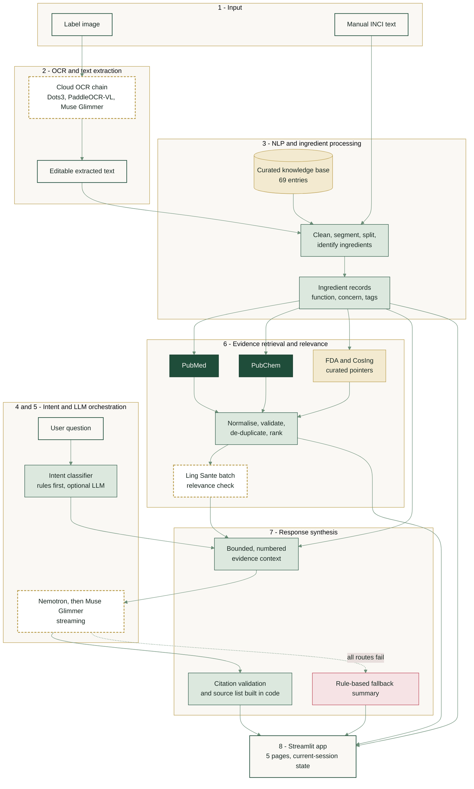
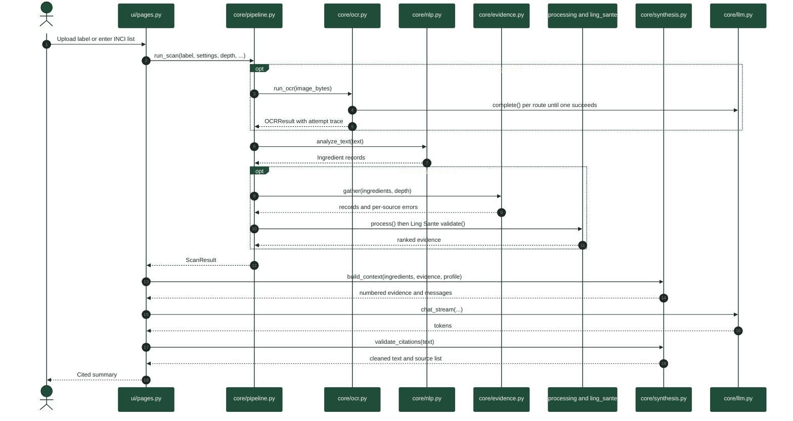
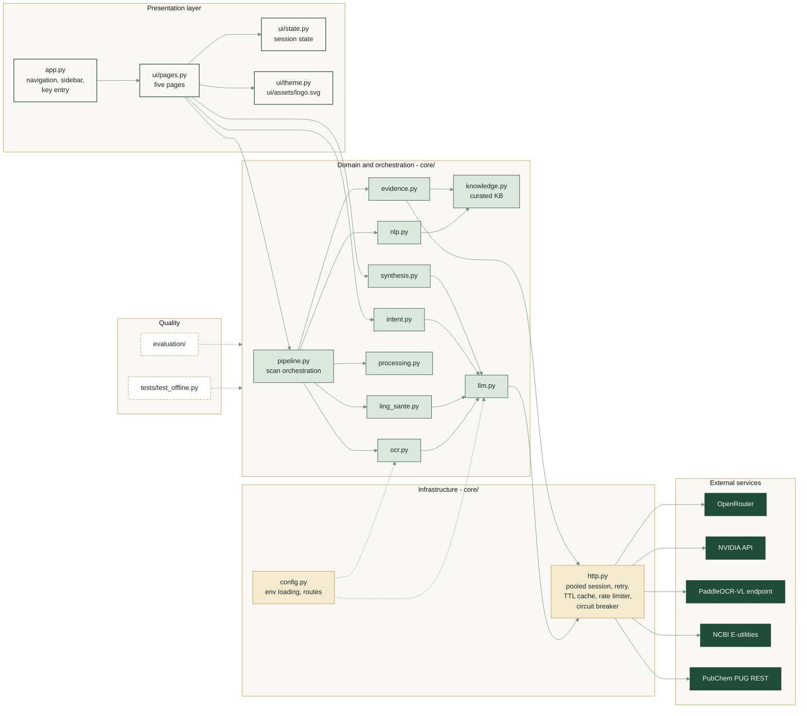
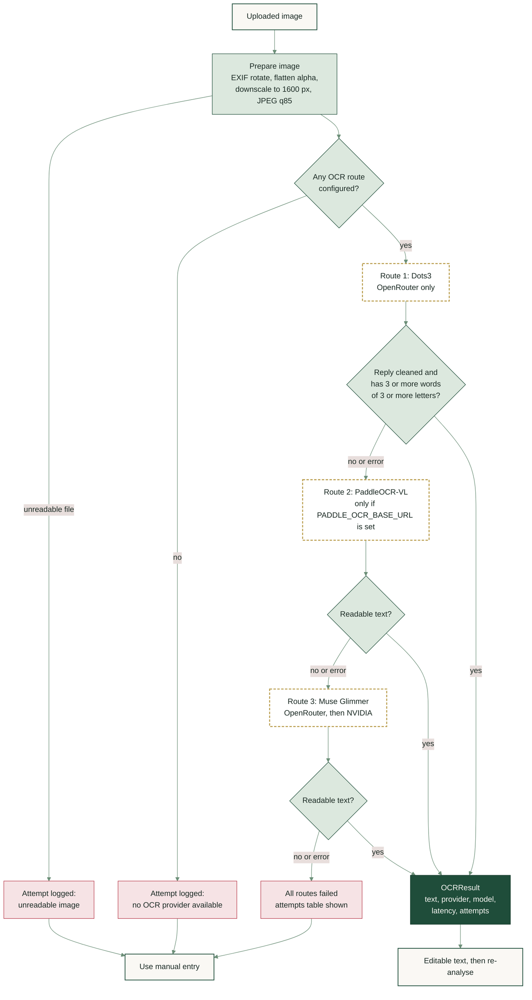
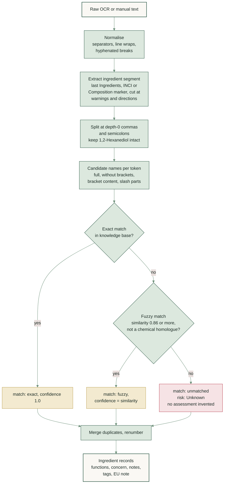
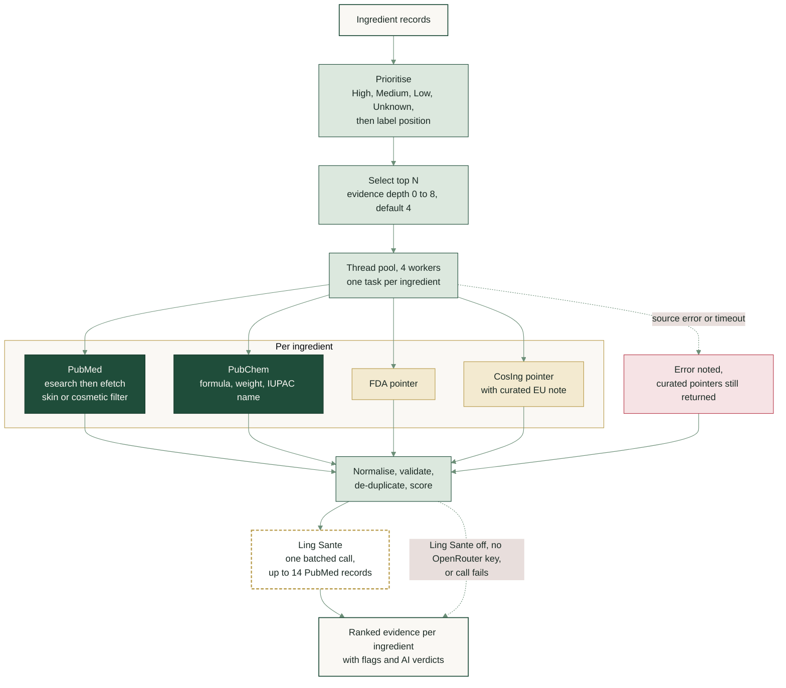
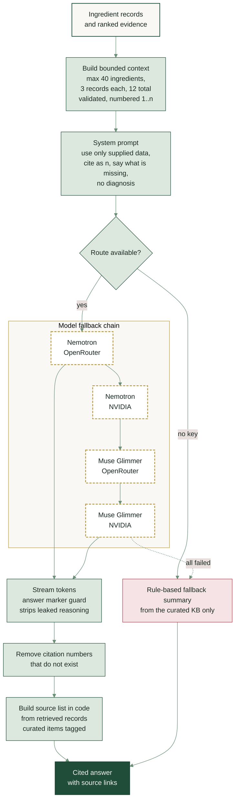

<div align="center">

<h1>COSMOS</h1>

<h3>Cosmetic Ingredient Intelligence</h3>

<p><em>From cosmetic label extraction to evidence-grounded ingredient intelligence.</em></p>

<p>
  
  
  
  
  
  
</p>

<p>
  <a href="#overview"><b>Overview</b></a> ·
  <a href="#architecture"><b>Architecture</b></a> ·
  <a href="#pipeline-stages"><b>Pipeline</b></a> ·
  <a href="#quick-start"><b>Quick start</b></a> ·
  <a href="#configuration-and-api-integrations"><b>Configuration</b></a> ·
  <a href="#evaluation"><b>Evaluation</b></a> ·
  <a href="#security-privacy-and-responsible-use"><b>Responsible use</b></a> ·
  <a href="#troubleshooting"><b>Troubleshooting</b></a>
</p>


<sub>Graphical abstract of the COSMOS pipeline. The diagrams below describe the implemented source code in detail.</sub>

</div>

---

## Overview

**COSMOS** is a Streamlit application that turns a cosmetic product's ingredient label (a photograph, or a pasted INCI list) into a structured ingredient analysis, supported by scientific literature, chemical records and regulatory reference pointers, and explained through a citation-checked, LLM-generated summary.

It is built around one principle: **every statement should be traceable to its kind of origin.** An ingredient name read from an image, a function stored in a curated table, a paper retrieved from PubMed and a sentence written by a language model are different things, and COSMOS keeps them separate in code and in the interface.

| | |
|---|---|
| **Input** | Label image (JPEG, PNG or WebP, up to 10 MB by default) or manually entered ingredient text |
| **Output** | Ingredient table with match status, functions and curated concern level; ranked evidence records; a cited summary; a grounded question-and-answer assistant |
| **Runtime** | Python and Streamlit. **API-only:** no OCR or language model is downloaded or run locally; no GPU is required |
| **Live sources** | NCBI PubMed (E-utilities) and PubChem (PUG REST), queried at request time |
| **Curated sources** | A hand-maintained knowledge base of 69 ingredient entries, plus FDA and EU CosIng pointer cards with links to the official databases |
| **AI components** | Cloud OCR models, Nemotron and Muse Glimmer for synthesis, an optional Ling Sante relevance check, and an optional LLM intent fallback |
| **Quality checks** | 15 offline unit tests (no keys, no network) and an evaluation suite in [`evaluation/`](evaluation/) |

> [!IMPORTANT]
> COSMOS is an informational research aid. It does not diagnose, certify product safety, determine allergy status or replace professional medical or dermatological advice. See [Security, privacy and responsible use](#security-privacy-and-responsible-use).

<details>
<summary><b>Table of contents</b></summary>

1. [Overview](#overview)
2. [Information provenance](#information-provenance)
3. [Architecture](#architecture)
4. [Pipeline stages](#pipeline-stages)
5. [Quick start](#quick-start)
6. [Configuration and API integrations](#configuration-and-api-integrations)
7. [Application walkthrough](#application-walkthrough)
8. [Evaluation](#evaluation)
9. [Reliability engineering](#reliability-engineering)
10. [Technology stack and repository layout](#technology-stack-and-repository-layout)
11. [Security, privacy and responsible use](#security-privacy-and-responsible-use)
12. [Limitations](#limitations)
13. [Troubleshooting](#troubleshooting)
14. [Roadmap](#roadmap)
15. [References](#references)
16. [Project](#project)

</details>

---

## Information provenance

COSMOS combines four kinds of information. They are not interchangeable, and the distinction is the main design contract of the project.

| Class | Examples in COSMOS | Produced by | How it appears | How to treat it |
|---|---|---|---|---|
| **Live API** | PubMed article metadata and abstracts; PubChem formula, molecular weight and IUPAC name | Network requests to NCBI and PubChem at query time (cached in memory for one hour) | Source pill (`PubMed`, `PubChem`) with record ID and a link to the original record | Primary records. Literature discovery is not proof of efficacy or safety; chemical identity is not a dermal-safety assessment |
| **Curated reference** | Ingredient functions, concern level, notes, tags, EU notes in `core/knowledge.py`; FDA and CosIng cards | Hand-maintained tables in the repository | FDA and CosIng cards carry a **curated pointer** label; cited curated items are tagged in the source list | Navigation aid, not a live regulatory lookup. Verify current law at the linked official source |
| **Deterministic computation** | Text cleaning, ingredient splitting, exact and fuzzy matching, evidence scoring, citation validation | Plain Python, no network | Match type (`exact`, `fuzzy`, `unmatched`) and confidence per ingredient | Reproducible and testable, but bounded by the heuristics and the finite knowledge base |
| **AI-generated interpretation** | OCR transcription, Ling Sante relevance verdicts, summaries and assistant answers, optional LLM intent label | Language and vision models through remote APIs | "Generated by" caption naming the model route, or `rule-based` when no model answered; an *AI check* column in the evidence validation view | Interpretation, not a primary source. Citation numbers are validated in code, but claim-level support is not |

---

## Architecture

All diagrams use one visual language.

| Style | Meaning |
|---|---|
| Solid forest green | Live external API |
| Light gold | Curated reference |
| Sage | Deterministic code |
| Dashed gold outline | AI-model step |
| Ivory | User input, output or interface |
| Rose | Failure or degraded path |

### End-to-end pipeline

The eight stages match the graphical abstract. The scan path (input to evidence) runs once per label; the question path (intent to synthesis) runs per assistant question and reuses the scan's evidence.



### Request sequence



### Software architecture

The `core/` package never imports Streamlit, so the whole pipeline can be tested and reused without the UI. Every outbound HTTP call goes through `core/http.py`.



| Layer | Responsibility | Modules |
|---|---|---|
| Presentation | Navigation, user input, rendering, current-session state | `app.py`, `ui/pages.py`, `ui/state.py`, `ui/theme.py` |
| Domain and orchestration | OCR, NLP, intent, evidence, ranking, synthesis, scan orchestration | `core/pipeline.py`, `ocr.py`, `nlp.py`, `knowledge.py`, `intent.py`, `evidence.py`, `processing.py`, `ling_sante.py`, `synthesis.py`, `llm.py` |
| Infrastructure | Settings and provider routes; pooled HTTP, caching, rate limiting, circuit breaking | `core/config.py`, `core/http.py` |
| Quality | Offline unit tests and evaluation tooling | `tests/`, `evaluation/` |

---

## Pipeline stages

Each stage below states what goes in, what happens, what comes out and how failure is handled. Stage numbers follow the graphical abstract.

### Stage 1: Input acquisition

| | |
|---|---|
| **Inputs** | A JPEG, PNG or WebP image, or free text typed into the manual tab |
| **Operations** | The Scanner page enforces the upload limit (`MAX_UPLOAD_SIZE_MB`, default 10). Manual text is passed straight to Stage 3 |
| **Outputs** | Image bytes (for Stage 2) or raw text (for Stage 3) |
| **Failure handling** | An oversize file is rejected with a message and the button is disabled. Manual entry works with no API keys at all |

### Stage 2: OCR and provider fallback

`core/ocr.py` prepares the image, then tries an ordered chain of cloud OCR routes. Nothing runs locally.



| | |
|---|---|
| **Inputs** | Image bytes; settings holding the available routes |
| **Operations** | Honour EXIF orientation; flatten transparency onto white; downscale to a maximum side of 1,600 px; encode as JPEG (quality 85); send a transcription prompt at temperature 0 with up to 1,500 output tokens; strip code fences, JSON layout wrappers and stray HTML tags from the reply; accept the reply only if it contains at least three words of three or more letters |
| **Outputs** | `OCRResult`: text, winning provider, model, total latency and an attempt-level trace (provider, success, seconds, error) |
| **Failure handling** | A route is skipped when not configured. Each provider failure is recorded and the next route is tried. Failing model routes enter a cool-down (see [Reliability engineering](#reliability-engineering)). If every route fails, the Scanner shows the attempts table and tips, and the user can type the list manually. The extracted text stays editable so recognition errors can be corrected before re-analysis |

| Order | Provider | Route | Needs |
|---:|---|---|---|
| 1 | Dots3 | OpenRouter | `OPENROUTER_API_KEY` |
| 2 | PaddleOCR-VL | Configured OpenAI-compatible cloud endpoint | `PADDLE_OCR_BASE_URL` (key optional) |
| 3 | Muse Glimmer | OpenRouter, then NVIDIA | `OPENROUTER_API_KEY` and/or `NVIDIA_API_KEY` |

> [!NOTE]
> PaddleOCR-VL is called through a remote endpoint. COSMOS does not install or run PaddleOCR locally.

### Stage 3: NLP and ingredient identification

`core/nlp.py` is deterministic and makes no network call. Function, concern level, notes and tags come from the curated knowledge base in `core/knowledge.py`.



| | |
|---|---|
| **Inputs** | Raw text from OCR or manual entry |
| **Operations** | Normalise separators and line wraps; locate the ingredient section using markers such as `Ingredients`, `INCI`, `Composition`, `Zutaten` or `Ingredientes` (the last marker wins when a label repeats it) and cut at warning, directions or manufacturing text; split on commas and semicolons outside brackets, while keeping numeric commas such as `1,2-Hexanediol`; match each token against the knowledge base. Fuzzy matching needs a similarity of at least 0.86 and a candidate of at least five characters, and a chemical-prefix guard stops homologues such as *dipropylene glycol* from being matched to *propylene glycol* |
| **Outputs** | A list of `Ingredient` records: position, raw text, canonical name, match type, confidence, functions, concern level (`High`, `Medium`, `Low`, `Unknown`), note, EU note and tags. Optional skin-profile flags (sensitive skin, pregnant or nursing, acne-prone skin, known fragrance allergy) are derived from tags |
| **Failure handling** | An unrecognised ingredient stays **Unknown** instead of receiving an invented profile. If text is read but no ingredient list can be separated, the Scanner says so and suggests editing the text or using manual entry |

The knowledge base holds **69 curated entries** (126 indexed names and aliases). It is intentionally small and hand-checked, so unlisted ingredients are reported as unrecognised, never guessed.

### Stage 4: Intent classification

`core/intent.py` classifies each assistant question into one of seven labels.

| Intent | Example |
|---|---|
| `ingredient_function` | What does niacinamide do? |
| `ingredient_safety` | Could this ingredient irritate sensitive skin? |
| `ingredient_identification` | What is this INCI name? |
| `regulatory_status` | Is this ingredient restricted in the EU? |
| `product_suitability` | Is this product suitable for oily skin? |
| `evidence_lookup` | What research is available for this ingredient? |
| `general_cosmetic` | A general cosmetic-information question |

| | |
|---|---|
| **Inputs** | The question; names in the current scan; knowledge-base aliases |
| **Operations** | Score regular-expression patterns per intent and derive a confidence. Only when rule confidence is below 0.55, `LLM_INTENT_FALLBACK` is enabled and an LLM route exists, ask the model for a single label. Detect ingredient mentions by alias |
| **Outputs** | Intent, confidence, method (`rules`, `llm` or `default`) and mentioned ingredients, shown beneath each assistant answer |
| **Failure handling** | If the LLM call fails or returns no valid label, the rule-based result is kept. The rule path needs no credentials |

### Stage 5: LLM orchestration

`core/llm.py` is an OpenAI-compatible chat client used for every model call (OCR vision, synthesis, intent fallback, evidence validation).

| | |
|---|---|
| **Inputs** | Message list and an ordered route list from `core/config.py` |
| **Operations** | Try Nemotron first, then Muse Glimmer, each through OpenRouter and then NVIDIA when both keys exist. Ask reasoning models to answer directly (provider-specific parameter, retried without it on HTTP 400). Stream tokens from the first route that responds |
| **Outputs** | Streamed text and the label of the route that answered |
| **Failure handling** | Authentication errors, unknown models, rate limits, timeouts and empty replies move on to the next route and place the failing route in a timed cool-down. If every route fails, an `LLMError` summarising each attempt is raised and Stage 7 uses the rule-based fallback |

### Stage 6: Evidence retrieval and relevance

`core/evidence.py` gathers records for the highest-priority ingredients, and `core/processing.py` and `core/ling_sante.py` validate and rank them.



| Source | Type | What is retrieved or shown |
|---|---|---|
| [PubMed](https://pubmed.ncbi.nlm.nih.gov/) | **Live** NCBI E-utilities (`esearch`, `efetch`) | Title, journal, year, publication-type signal and abstract text (first 700 characters). Query: ingredient terms in title or abstract, combined with *skin*, *cosmetic*, *dermatolog\**, or *topical*; top results sorted by relevance (3 per ingredient by default) |
| [PubChem](https://pubchem.ncbi.nlm.nih.gov/) | **Live** PUG REST by compound name | Molecular formula, molecular weight and IUPAC name where available, with a link to the compound record |
| [U.S. FDA](https://www.fda.gov/cosmetics/cosmetics-laws-regulations/prohibited-restricted-ingredients-cosmetics) | **Curated pointer** | Regulatory framing text and a link to the FDA prohibited and restricted ingredients page |
| [EU CosIng](https://single-market-economy.ec.europa.eu/sectors/cosmetics/cosmetic-ingredient-database_en) | **Curated pointer** | The knowledge-base EU note for recognised ingredients (for example an Annex reference) and a link to the CosIng database |

> [!WARNING]
> FDA and CosIng are **not** queried through live ingredient APIs. Their cards are curated notes with links to the official databases, and are labelled *curated pointer* in the interface. Confirm current legal status, concentration limits and jurisdiction at the official source.

| | |
|---|---|
| **Inputs** | Ingredient records; evidence depth from the sidebar (0 to 8, default 4; 0 skips retrieval at scan time) |
| **Operations** | Prioritise by concern level, then label position; retrieve in parallel; skip PubMed and PubChem where the knowledge base says there is nothing sensible to search (for example water); search unrecognised ingredients by their literal name. Then normalise text, validate fields and HTTPS source links, de-duplicate by URL or title, check that the ingredient is named in the title or abstract, and score by source weight (FDA and CosIng 1.0, PubMed 0.7, PubChem 0.6), review status, recency (last six years), skin-related terms and title hits. Records that fail validation sort below validated ones. Optionally, Ling Sante labels up to 14 PubMed abstracts as `relevant`, `weak` or `irrelevant` and adjusts scores; `irrelevant` records are marked as needing review |
| **Outputs** | Per-ingredient ranked evidence lists with `validated`, `score`, `flags` and optional `ai_verdict` fields |
| **Failure handling** | Each source fails independently and the error is recorded as a source note. Curated regulatory pointers are always returned. An overall retrieval timeout keeps whatever has arrived. Network failure never aborts a scan. If Ling Sante is disabled, unconfigured or fails, the deterministic ranking is kept |

Ling Sante is a secondary relevance signal. It does not appraise study design or establish validity.

### Stage 7: Response synthesis and citation validation

`core/synthesis.py` builds a bounded context for the model and checks what comes back.



| | |
|---|---|
| **Inputs** | Ingredient records, ranked evidence, skin-profile flags, question and recent chat history (last four turns, 1,200 characters each) |
| **Operations** | Select up to 40 ingredients and up to 3 validated records per ingredient (12 in total) and number them. FDA pointer cards are not included in the model context, and PubMed records must name the ingredient in the title to be included. The model is instructed to use only the supplied data, cite as `[n]`, state gaps, and avoid diagnosis. Stream the answer; a final-answer marker lets code discard any leaked reasoning. Remove citation numbers that do not exist; build the source list from the retrieved records, so links cannot be invented |
| **Outputs** | A Markdown summary (key takeaways, ingredient-wise analysis, limitations, plain-words summary) or a short assistant answer, followed by a **Sources** list and a caption naming the model route or `rule-based` |
| **Failure handling** | If no route responds, or the model returns only reasoning, a deterministic rule-based summary built from the curated knowledge base is shown, labelled as such. The assistant falls back to knowledge-base notes |

> [!NOTE]
> Citation validation guarantees that every `[n]` refers to a record that was actually supplied. It does **not** prove that the cited record supports the specific sentence.

### Stage 8: Streamlit application

| Page | Purpose |
|---|---|
| **Ingredient Scanner** | Upload an image or paste an INCI list; inspect the pipeline trace (OCR attempts, timings, source notes); edit extracted text and re-analyse; generate the summary |
| **Ingredient Intelligence** | Filterable table of ingredients with function, concern level, profile flags and PubMed study counts; fetch evidence for ingredients not yet researched |
| **Evidence Explorer** | Look up an ingredient from the scan or any ingredient name; inspect records by source; view the evidence validation table, including the AI check |
| **AI Assistant** | Ask questions grounded in the current ingredient and evidence context; intent, method and model route are shown with each answer |
| **History (Current Session)** | Scans, lookups and questions in the active browser session; cleared with *Clear session* |

---

## Quick start

### Prerequisites

- Python **3.10 or newer** (the test suite was run on Python 3.12)
- Git
- Internet access for cloud OCR, language models and live evidence retrieval
- API keys for the optional provider-backed features (see [Configuration](#configuration-and-api-integrations))

No GPU or local model runtime is needed.

### Windows PowerShell

```powershell
# 1. Clone the repository
git clone https://github.com/siddhi-lad/COSMOS.git
Set-Location COSMOS

# 2. Create a virtual environment (use "py -3.11" etc. to pick a specific installed version)
py -3 -m venv .venv

# 3. Activate it
.\.venv\Scripts\Activate.ps1

# 4. Install dependencies
python -m pip install --upgrade pip
python -m pip install -r requirements.txt

# 5. Create your local environment file, then add keys
Copy-Item .env.example .env
notepad .env

# 6. Launch COSMOS
python -m streamlit run app.py
```

If PowerShell refuses to run the activation script, allow it for the current terminal only, then activate again:

```powershell
Set-ExecutionPolicy -Scope Process -ExecutionPolicy Bypass
.\.venv\Scripts\Activate.ps1
```

### macOS and Linux

```bash
git clone https://github.com/siddhi-lad/COSMOS.git
cd COSMOS

python3 -m venv .venv
source .venv/bin/activate

python -m pip install --upgrade pip
python -m pip install -r requirements.txt

cp .env.example .env      # then add your keys
python -m streamlit run app.py
```

Streamlit serves the app at <http://localhost:8501>.

<details>
<summary><b>VS Code setup</b></summary>

1. Open the cloned `COSMOS` folder (**File → Open Folder**).
2. Open the integrated terminal and create and activate `.venv` as above.
3. Run **Python: Select Interpreter** from the Command Palette and choose the interpreter inside `.venv`.
4. Install the requirements and launch Streamlit from the terminal.

</details>

### Verify the installation

```powershell
# 15 offline tests: no API keys, no network
python -m unittest discover -s tests -v
```

Then in the app: open **Ingredient Scanner → Enter ingredients manually**, paste `Aqua, Glycerin, Niacinamide, Phenoxyethanol, Carbomer, Parfum`, and choose **Analyze ingredients**. Expand **Pipeline trace** to see timings and any source notes. On first use with keys, open the sidebar **Connections → Check model ids** to confirm that the configured model IDs exist.

---

## Configuration and API integrations

COSMOS reads environment variables and a project-root `.env` file (next to `app.py`, then the working directory). The loader tolerates the encodings Windows editors produce (UTF-8, UTF-8 with BOM, UTF-16, cp1252) and overrides variables that exist but are empty. Keys can also be pasted into the sidebar for the current session; those values live only in the running process.

### API integrations

| Integration | Role | Endpoint | Credential | Notes |
|---|---|---|---|---|
| **OpenRouter** | Dots3 OCR, Muse Glimmer OCR and synthesis, Nemotron synthesis, Ling Sante | `https://openrouter.ai/api/v1` | `OPENROUTER_API_KEY` | One key covers all OpenRouter-routed models |
| **NVIDIA API** | Second route for Nemotron and Muse Glimmer | `https://integrate.api.nvidia.com/v1` | `NVIDIA_API_KEY` | Optional |
| **PaddleOCR-VL** | OCR route 2 | Your OpenAI-compatible cloud endpoint | `PADDLE_OCR_BASE_URL` (required to enable), `PADDLE_OCR_API_KEY` (optional) | Not enabled without a URL |
| **NCBI E-utilities** | PubMed literature | `https://eutils.ncbi.nlm.nih.gov/entrez/eutils` | None required; `NCBI_API_KEY` and `NCBI_EMAIL` optional | A key raises the request rate (about 3 to 10 requests per second); COSMOS spaces requests accordingly |
| **PubChem PUG REST** | Chemical records | `https://pubchem.ncbi.nlm.nih.gov/rest/pug` | None | Requests are rate limited to stay within PubChem's published limit |
| **FDA and CosIng** | Regulatory pointers | Links only | None | No API is called |

Some default model IDs are `:free` variants, which providers may rate limit or retire. Model availability, pricing and quotas are set by each provider and can change.

### Starter `.env`

```dotenv
OPENROUTER_API_KEY=
NVIDIA_API_KEY=
PADDLE_OCR_API_KEY=
PADDLE_OCR_BASE_URL=
NCBI_API_KEY=
NCBI_EMAIL=

DOTS_MODEL=dots-studio/dots-3-note-preview:free
NEMOTRON_MODEL=nvidia/nemotron-3.5-lightning-30b-a3b
MUSE_MODEL=nvidia/muse-glimmer-30b-a3b
```

<details>
<summary><b>All environment variables</b></summary>

**In `.env.example`**

| Variable | Required | Purpose |
|---|---|---|
| `OPENROUTER_API_KEY` | Optional, recommended | Enables OpenRouter routes for Dots3, Nemotron, Muse Glimmer and Ling Sante |
| `NVIDIA_API_KEY` | Optional | Enables NVIDIA routes for Nemotron and Muse Glimmer |
| `PADDLE_OCR_API_KEY` | Optional | Credential for the PaddleOCR-VL endpoint, if it requires one |
| `PADDLE_OCR_BASE_URL` | Optional | OpenAI-compatible PaddleOCR-VL base URL; the route is off without it |
| `NCBI_API_KEY` | Optional | Raises the PubMed request-rate allowance |
| `NCBI_EMAIL` | Optional | Contact email sent with NCBI requests |
| `DOTS_MODEL` | Optional | Dots3 model ID |
| `NEMOTRON_MODEL` | Optional | Primary synthesis model ID |
| `MUSE_MODEL` | Optional | OCR and synthesis fallback model ID |

**Recognised by the code but not in `.env.example`**

| Variable | Default | Purpose |
|---|---:|---|
| `PADDLE_OCR_MODEL` | `PaddlePaddle/PaddleOCR-VL` | PaddleOCR-VL model ID |
| `LING_SANTE_MODEL` | `inclusionai/ling-3.0-flash-sante:free` | Evidence-relevance model ID |
| `REQUEST_TIMEOUT` | `90` s | Base timeout from which OCR and LLM timeouts are capped |
| `OCR_TIMEOUT` | `min(REQUEST_TIMEOUT, 90)` s | OCR request timeout |
| `LLM_TIMEOUT` | `min(REQUEST_TIMEOUT, 90)` s | LLM request timeout |
| `EVIDENCE_TIMEOUT` | `12` s | Per-request evidence timeout |
| `MAX_UPLOAD_SIZE_MB` | `10` | Application upload limit (`.streamlit/config.toml` also sets `maxUploadSize = 10`) |
| `LLM_INTENT_FALLBACK` | on | Optional LLM fallback for ambiguous intent classification |
| `LING_SANTE_ENABLED` | on | Optional Ling Sante evidence check (also a sidebar toggle) |
| `LOG_LEVEL` | `INFO` | Python logging level |

</details>

<details>
<summary><b>Streamlit Community Cloud secrets</b></summary>

In the app's **Settings → Secrets** panel, add only the variables you use, in TOML:

```toml
OPENROUTER_API_KEY = "your-openrouter-key"
NVIDIA_API_KEY = "your-nvidia-key"
NCBI_API_KEY = "your-ncbi-key"
NCBI_EMAIL = "you@example.com"

DOTS_MODEL = "dots-studio/dots-3-note-preview:free"
NEMOTRON_MODEL = "nvidia/nemotron-3.5-lightning-30b-a3b"
MUSE_MODEL = "nvidia/muse-glimmer-30b-a3b"
```

Never paste real keys into source code, screenshots, issues, commits or documentation.

</details>

### What works with which keys

| Configuration | Available |
|---|---|
| **No keys** | Manual entry; deterministic identification; functions and curated notes; live PubMed and PubChem retrieval (network only); curated FDA and CosIng pointers; rule-based summaries |
| **`OPENROUTER_API_KEY`** | Adds Dots3 and Muse Glimmer OCR, Nemotron and Muse Glimmer synthesis, the assistant, optional Ling Sante validation and LLM intent fallback |
| **`NVIDIA_API_KEY`** | Adds a second route for Nemotron and Muse Glimmer synthesis and OCR |
| **`PADDLE_OCR_BASE_URL`** | Enables PaddleOCR-VL as OCR route 2 |
| **`NCBI_API_KEY`** | Faster PubMed retrieval |

---

## Application walkthrough

The interface follows the forest green and warm ivory theme defined in [`.streamlit/config.toml`](.streamlit/config.toml): primary `#1F4D3A`, background `#FAF8F4`, secondary background `#EEF3EE`, text `#1B2A24`.

1. Open **Ingredient Scanner** and paste a short list, for example `Aqua, Glycerin, Niacinamide, Phenoxyethanol`.
2. Select **Analyze ingredients** and review canonical names, match type and confidence.
3. Expand **Pipeline trace** for timings, OCR attempts (image input) and source notes.
4. Open **Ingredient Intelligence** to filter by concern level and see PubMed counts.
5. Open **Evidence Explorer** to read the records behind each claim and open the original sources.
6. Generate the summary or ask the **AI Assistant** a focused question; follow the numbered sources.

### Screenshots

No application screenshots are committed to this repository. Rather than fabricate any, this README shows only the project's graphical abstract, which is a conceptual overview and not a screen capture. Verified screenshots can be added under `docs/images/` and referenced here.

---

## Evaluation

COSMOS ships an evaluation suite in [`evaluation/`](evaluation/). The repository does not commit result artefacts (`results/`, the private gold set and the downloaded dataset are git-ignored), so the figures below are reported from the project's graphical abstract and are presented with the context needed to read them correctly.

### Reported results

These values are reproduced unchanged from the graphical abstract's *Reported evaluation: current implementation* panel.

| Evaluation aspect | Reported value | What it concerns |
|---|---:|---|
| Ingredient extraction / identification | **80.2%** | Matching extracted ingredients to reference ingredient lists. Identification precision, recall and F1 are the metrics defined in `evaluation/toxfox_eval.py` |
| OCR pipeline (59 label images) | **84.9%** | End-to-end image-to-text stage on 59 label images. The abstract does not state which OCR measure the percentage reports (the tooling also reports CER, WER, success rate and latency) |
| Knowledge-base coverage | **41.8%** | In the evaluation code, the per-label share of identified ingredients that were matched in the curated knowledge base, averaged over labels |
| Risk-flag F1 | **2.6%** | Agreement between COSMOS's Medium and High concern flags and an external pollutant list |
| Line-break splitting ablation | **51.9%** | Result with line-break handling switched off; the ablation script switches off one NLP component at a time and re-measures identification |

**How to read these numbers**

- **Knowledge-base coverage is a scope measure, not an accuracy measure.** With 69 curated entries, many label ingredients are unrecognised; they are reported as **Unknown** instead of being guessed. Coverage is the principal limitation on function and concern output.
- **Risk-flag F1 is low by design and expected.** The knowledge base contains only a few of the substances on the external pollutant list the flags are checked against. The evaluation documentation treats this as a coverage limitation, not as an accuracy score of the curated concern labels. Do not conflate it with the identification F1.
- **The line-break ablation shows why newline handling exists.** Reading the ablation figure next to the 80.2% identification result indicates the size of the effect on this evaluation set; neither figure generalises to all labels.
- **The OCR figure depends on its protocol.** A 59-image sample, one dataset and a chosen success definition support a descriptive result, not a general claim about all packaging, scripts or photographic conditions.
- **Reference data and cached outputs are not distributed.** To verify any value, rerun the protocol below and report the dataset, sample size, seed, metric definition and confidence intervals alongside it.

### Evaluation tooling

| Script | Purpose | Needs |
|---|---|---|
| [`evaluation/toxfox_eval.py`](evaluation/toxfox_eval.py) | Identification P/R/F1, exact match, knowledge-base coverage and concern-flag test on text; OCR CER, WER, success rate, latency and end-to-end identification per route and for the full chain; robustness (`blur`, `lowres`, `jpeg`, `dark`). Reports 95% bootstrap confidence intervals with a fixed seed | Dataset; OCR mode needs keys |
| [`evaluation/ablation.py`](evaluation/ablation.py) | Switches off fuzzy matching, the prefix guard, line-break splitting and the synonym merge one at a time; paired Wilcoxon test with Holm correction; knowledge-base gap analysis; NLP latency | Dataset only |
| [`evaluation/annotation_tools.py`](evaluation/annotation_tools.py) | Workflow for human-labelled parts: intent questions, evidence relevance, answer quality; scores accuracy, macro-F1, kappa, P@3, MRR, nDCG@5 and citation precision | Human raters |
| [`evaluation/complete_evaluation.py`](evaluation/complete_evaluation.py) | Robustness reruns and gap-filling helpers | Dataset, keys |
| [`evaluation/evaluate.py`](evaluation/evaluate.py) | Compact runner for identification, function and risk accuracy, rule-based intent accuracy and macro-F1, OCR, and NLP latency | A labelled gold file you supply |
| [`evaluation/EVALUATION.md`](evaluation/EVALUATION.md) | Run order, commands and interpretation limits for every table | — |

<details>
<summary><b>Reproduce the ToxFox evaluation</b></summary>

The protocol uses the public ToxFox OCR dataset (`ki-iw/toxfox-ocr`). Check its licence before redistributing any images.

```powershell
python -m pip install -r evaluation/requirements-eval.txt

# Download image + .yaml pairs from github.com/ki-iw/toxfox-ocr (data/images and data/ground_truth)
# into one folder named data_tox/. The pollutant mapping is already in evaluation/data/.

python evaluation/toxfox_eval.py --data data_tox --mode text                 # offline, seconds
python evaluation/ablation.py --data data_tox                                # offline ablation + KB gaps + latency
python evaluation/toxfox_eval.py --data data_tox --mode ocr --routes dots --no-chain --pause 3   # needs OPENROUTER_API_KEY
python evaluation/toxfox_eval.py --data data_tox --mode ocr --degrade blur   # also: lowres, jpeg, dark
```

Outputs (`.md`, `.csv`, `.tex`, `.json`, plus a run manifest) are written to `results/`. OCR output is cached, so reruns are free. Free-tier rate limits can cause failed calls; they count against the success rate rather than being hidden.

</details>

<details>
<summary><b>Compact runner and gold-file format</b></summary>

`evaluation/evaluate.py` defaults to `evaluation/gold.json`, which is **intentionally git-ignored** (private annotations) and therefore absent from a fresh clone. Supply your own file with `--gold`:

```json
{
  "samples": [
    {
      "text": "Ingredients: Aqua, Glycerin, Niacinamide",
      "ingredients": ["Aqua", "Glycerin", "Niacinamide"],
      "functions": {"Glycerin": "Humectant"},
      "risk": {"Glycerin": "Low"}
    }
  ],
  "intents": [["What does niacinamide do?", "ingredient_function"]]
}
```

```powershell
python evaluation/evaluate.py --gold path\to\gold.json
python evaluation/evaluate.py --gold path\to\gold.json --latency
python evaluation/evaluate.py --gold path\to\gold.json --ocr-dir data/ocr   # folder of label.jpg + label.txt pairs
```

A starter gold set written against the knowledge base scores trivially high; use an independently labelled set for meaningful numbers.

</details>

> [!NOTE]
> **Annotation caveat.** `evaluation/apply_llm_labels.py` can fill the intent-label column using an LLM annotator. Its own documentation describes the result as an LLM-annotated pilot, not human ground truth. Report rater count, independence and agreement (kappa) for any intent or evidence-relevance result.

### Unit tests

```powershell
python -m unittest discover -s tests -v
```

The 15 tests use mocks and fixed samples. They cover ingredient parsing and fuzzy matching, skin-profile flags, intent rules, evidence parsing and processing, graceful network failure, Ling Sante parsing and silent failure, reasoning-leak removal, citation validation, the rule-based fallback and the OCR fallback chain. They need no keys and no network.

---

## Reliability engineering

All outbound calls share one pooled session in `core/http.py`. Resilience is layered so that no single provider failure aborts a scan.

| Mechanism | Behaviour |
|---|---|
| **Connection pooling** | One shared `requests` session with a 16-connection pool |
| **Retry** | One retry with backoff on HTTP 500, 502, 503 and 504 |
| **TTL cache** | Successful PubMed and PubChem results cached in memory for one hour (up to 1,024 entries); model catalogues cached for ten minutes |
| **Rate limiting** | PubMed spaced at about 0.36 s without an NCBI key and 0.11 s with one; PubChem at 0.22 s |
| **Circuit breaker** | Failing model routes are skipped for a cool-down: 600 s for HTTP 400 or 404, 300 s for 401 or 403, 60 s for other HTTP errors, 45 s for 429, 30 s for timeouts, connection errors and empty replies. Changing a key in the sidebar resets the breaker |
| **Parallel retrieval** | Evidence for the selected ingredients is fetched with four workers; the overall retrieval timeout is three times `EVIDENCE_TIMEOUT` |
| **Bounded context** | At most 40 ingredients and 12 numbered evidence records reach the model |
| **Streaming** | Summaries and answers stream to the interface |
| **Graceful degradation** | Rule-based analysis, curated notes and a deterministic summary remain available when remote services fail |

| Design decision | Benefit | Trade-off |
|---|---|---|
| API-only inference | No model downloads or GPU; small dependency set | Network latency, quotas, provider uptime and possible usage costs |
| Small curated knowledge base | Predictable, auditable output for supported ingredients | Finite coverage; unlisted ingredients stay Unknown |
| Rule-first NLP and intent | Fast, deterministic, offline-testable baseline | Heuristics can fail on unusual layouts or ambiguous questions |
| LLM synthesis constrained to supplied evidence | Accessible explanations and conversation | Output can still be incomplete or misleading |
| Citation validation in code | No reference to evidence that was never supplied | Does not prove claim-level support |
| Curated regulatory pointers | Official resources are easy to find without implying a live regulatory API | Users must verify current records themselves |

---

## Technology stack and repository layout

| Layer | Implementation |
|---|---|
| Language and UI | Python, Streamlit (`>=1.40`) |
| Data and imaging | pandas, Pillow |
| Networking and configuration | requests with urllib3 retry adapter, python-dotenv |
| OCR | Dots3, PaddleOCR-VL (cloud endpoint), Muse Glimmer |
| Language models | Nemotron (primary), Muse Glimmer (fallback), Ling Sante (evidence relevance), all through OpenAI-compatible chat endpoints on OpenRouter and NVIDIA |
| Evidence | NCBI PubMed E-utilities, PubChem PUG REST, curated FDA and CosIng pointers |
| Testing and evaluation | `unittest`; evaluation extras (`pyyaml`, optional `scipy`) in `evaluation/requirements-eval.txt` |

<details>
<summary><b>Repository structure</b></summary>

```text
COSMOS/
├── app.py                      # Streamlit entry point: navigation, sidebar, key entry
├── requirements.txt            # streamlit, requests, Pillow, python-dotenv, pandas
├── .env.example                # Environment-variable template
├── .streamlit/config.toml      # Theme and server settings
├── docs/images/                # Graphical abstract
├── core/                       # Pipeline logic (no Streamlit imports)
│   ├── config.py               # Environment loading, settings, provider routes
│   ├── http.py                 # Session, retry, TTL cache, rate limiter, circuit breaker
│   ├── llm.py                  # OpenAI-compatible client, fallback chain, streaming
│   ├── ocr.py                  # Image preparation and OCR chain
│   ├── knowledge.py            # Curated ingredient knowledge base
│   ├── nlp.py                  # Cleaning, splitting, identification
│   ├── intent.py               # Rule-first intent classification
│   ├── evidence.py             # PubMed, PubChem and regulatory pointer retrieval
│   ├── processing.py           # Evidence validation, de-duplication, ranking
│   ├── ling_sante.py           # Batched LLM relevance check
│   ├── synthesis.py            # Context, prompts, citation validation, fallback
│   └── pipeline.py             # Scan orchestration
├── ui/
│   ├── pages.py                # The five pages
│   ├── state.py                # Current-session state
│   ├── theme.py                # Visual theme and components
│   └── assets/logo.svg         # Sidebar logo
├── evaluation/
│   ├── EVALUATION.md           # Run order and interpretation limits
│   ├── evaluate.py             # Compact gold-file runner
│   ├── toxfox_eval.py          # ToxFox identification and OCR evaluation
│   ├── ablation.py             # NLP ablation, KB gaps, latency
│   ├── annotation_tools.py     # Human-annotation workflow and scoring
│   ├── complete_evaluation.py  # Robustness reruns
│   ├── apply_llm_labels.py     # LLM-annotated intent pilot labels
│   ├── stats.py                # Bootstrap, Wilcoxon, Holm, run manifest
│   ├── requirements-eval.txt
│   └── data/pollutant_mapping.yml
└── tests/test_offline.py       # 15 offline unit tests
```

</details>

---

## Security, privacy and responsible use

### Credentials

- Keep `.env` local; it is git-ignored. Do not commit API keys.
- Use deployment secrets for hosted instances and rotate any key that is accidentally published.
- Keys entered in the sidebar are runtime configuration for the running process, not a secrets-management system.
- Do not share screenshots or logs that expose keys or provider account details.

### Data and privacy

- OCR and language-model calls use remote provider endpoints. Images, text and prompts sent to them are subject to those providers' terms, retention and privacy practices.
- Do not upload personal, confidential or sensitive material unless you are permitted to and have reviewed the relevant provider policies.
- History and assistant conversations live in Streamlit session state for the current browser session. They are not a database or a durable account history.
- API-only operation avoids local model downloads. It does not mean uploaded content stays on your machine.

### Informational-use disclaimer

COSMOS provides educational and informational ingredient analysis. It does not diagnose skin conditions, prescribe treatment, certify a product as safe, determine an individual's allergy status or replace professional medical or dermatological advice. Ingredient effects depend on concentration, formulation, exposure, frequency, route of use and individual context, none of which a label alone discloses. Anyone with persistent reactions or specific medical concerns should consult a qualified healthcare professional.

---

## Limitations

1. **OCR quality.** Blur, glare, curved packaging, small type, multilingual labels and unusual layouts can cause missing or wrong text. Always check and correct the extracted text.
2. **Finite knowledge base.** Only 69 curated entries; unrecognised ingredients receive no function or concern level. Concern levels are curated, not clinically validated.
3. **Fuzzy matching.** A fuzzy match can be wrong. Review the raw and canonical names and the confidence value.
4. **Regulatory coverage.** FDA and CosIng are curated pointers, not exhaustive live checks. Rules vary by jurisdiction and change over time.
5. **Evidence coverage.** PubMed results depend on query terms, indexing, abstract availability and retrieval depth (3 records per ingredient by default). No result is not evidence of no effect.
6. **Chemical versus toxicological evidence.** PubChem identity and properties do not establish dermal safety.
7. **Model reliability.** Language models can omit nuance or produce unsupported explanations. Grounding and citation-index validation reduce, but do not eliminate, hallucination; they do not verify that a cited record entails the claim.
8. **Provider dependency.** Outages, rate limits, retired model IDs, authentication failures and network conditions can reduce functionality.
9. **Session scope.** Scans and chats are not persisted beyond the browser session.
10. **Evaluation scope.** Reported figures come from a limited sample and one protocol. Clinical validity of risk labels, multilingual labels and user studies are not covered.

---

## Troubleshooting

<details>
<summary><b>Setup and configuration</b></summary>

| Symptom | Likely cause | Action |
|---|---|---|
| `streamlit` is not recognised | Virtual environment not active, or dependencies installed elsewhere | Activate `.venv`, run `python -m pip install -r requirements.txt`, and launch with `python -m streamlit run app.py` |
| PowerShell blocks `Activate.ps1` | Execution policy | `Set-ExecutionPolicy -Scope Process -ExecutionPolicy Bypass`, then activate again |
| `py -3.10` is not found | That Python version is not installed | Use `py -3 -m venv .venv`, or install the version you need |
| Changes to `.env` are ignored | Streamlit has not reloaded, or the file is not beside `app.py` | Restart Streamlit; confirm the file is named `.env` (not `.env.txt`) and sits in the project root; or paste keys in the sidebar |
| App starts but model features are unavailable | Missing or invalid credentials | Expand **Connections** in the sidebar and check the status line |

</details>

<details>
<summary><b>Providers and models</b></summary>

| Symptom | Likely cause | Action |
|---|---|---|
| `NOT FOUND` in **Check model ids**, or HTTP 404 | Model ID unavailable, renamed or unsupported on that route | Check the provider's current catalogue and update the relevant `*_MODEL` variable |
| HTTP 400 during OCR | The selected model does not accept images | Choose a vision-capable model |
| HTTP 401 or 403 / "authentication failed" | Wrong, expired or under-permissioned key | Generate a valid key and update `.env` or the deployment secret |
| HTTP 429 | Rate limit or quota reached | Wait for the limit to reset, review quota, avoid rapid repeated requests |
| "temporarily skipped (recent failure)" | The circuit breaker is in cool-down for that route | Wait for the cool-down, or change a key in the sidebar to reset it |
| OCR fails for every provider | No route configured, bad model ID, poor image or provider outage | Check routes and model IDs; use a sharp, well-lit photo; use manual entry |
| PaddleOCR-VL is skipped | `PADDLE_OCR_BASE_URL` not set | Set it to the provider's OpenAI-compatible base URL |
| "All LLMs failed" | Every route failed | Read the per-route messages; the app still returns a rule-based summary |

</details>

<details>
<summary><b>Evidence and evaluation</b></summary>

| Symptom | Likely cause | Action |
|---|---|---|
| PubMed retrieval is slow | Network delay, request throttling or a large depth | Add `NCBI_API_KEY` and `NCBI_EMAIL`; lower **Evidence depth** |
| Evidence is sparse | Synonyms or query terms do not match indexed records | Check the canonical name in the Evidence Explorer and search the source directly |
| "Evidence not fetched yet" | Depth was 0, or the ingredient was outside the top N | Use **Fetch evidence for remaining** or the Evidence Explorer |
| `evaluate.py` cannot find `gold.json` | The gold file is git-ignored by design | Supply your own file with `--gold`, or use the ToxFox scripts |
| ToxFox script cannot find data | `data_tox/` is not in the repository | Download the dataset as described in [Evaluation](#evaluation) |

</details>

---

## Roadmap

These are directions, not claims about existing functionality.

- Expand the knowledge base with versioned provenance and expert review.
- Add explicit synonym sources and calibrated match confidence.
- Build a larger, independently annotated OCR and INCI benchmark across packaging types, scripts and image conditions.
- Add claim-level evidence entailment checks and human-review workflows.
- Record regulatory provenance: jurisdiction, retrieval date, source version and record identifiers.
- Add structured exports of ingredient tables and evidence reports.
- Add durable, privacy-conscious history only with an explicit data-retention design.
- Evaluate retrieval with labelled relevance judgements (nDCG, MRR) and expert review of concern levels and explanations.
- Add mocked-HTTP integration tests for provider adapters.

---

## References

COSMOS uses or links to these public resources and services:

- [NCBI PubMed](https://pubmed.ncbi.nlm.nih.gov/) and [E-utilities documentation](https://www.ncbi.nlm.nih.gov/books/NBK25501/)
- [PubChem PUG REST documentation](https://pubchem.ncbi.nlm.nih.gov/docs/pug-rest)
- [U.S. FDA: Prohibited and Restricted Ingredients in Cosmetics](https://www.fda.gov/cosmetics/cosmetics-laws-regulations/prohibited-restricted-ingredients-cosmetics)
- [European Commission CosIng](https://single-market-economy.ec.europa.eu/sectors/cosmetics/cosmetic-ingredient-database_en)
- [ToxFox OCR dataset (ki-iw/toxfox-ocr)](https://github.com/ki-iw/toxfox-ocr), used by the evaluation scripts
- [Streamlit documentation](https://docs.streamlit.io/)
- [OpenRouter documentation](https://openrouter.ai/docs) and [NVIDIA API Catalog](https://build.nvidia.com/)

Thanks to the maintainers of these public scientific and technical resources and to the open-source Python ecosystem.

---

## Project

- **Repository:** [github.com/siddhi-lad/COSMOS](https://github.com/siddhi-lad/COSMOS)
- **Owner:** [siddhi-lad](https://github.com/siddhi-lad)
- **Issues and collaboration:** [open an issue](https://github.com/siddhi-lad/COSMOS/issues)
- **License:** no license file is currently included in the repository

---

<div align="center">

### COSMOS

**Transforming cosmetic ingredient labels into structured, evidence-backed intelligence.**

COSMOS — Cosmetic Ingredient Intelligence.

[github.com/siddhi-lad/COSMOS](https://github.com/siddhi-lad/COSMOS)

</div>
